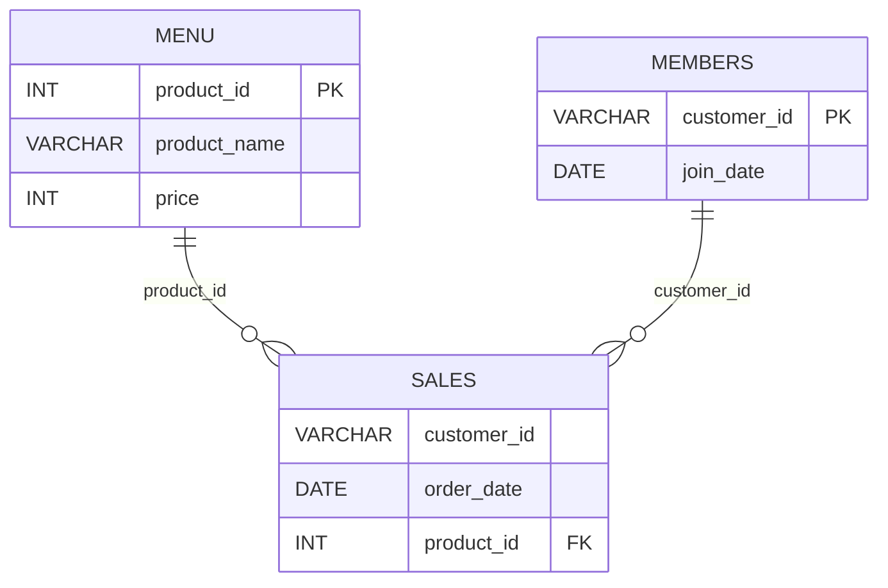

# Case Study 1: Danny's Diner

My analysis of the first case study in Danny Ma's 8 Week SQL Challenge. I will add my own SQL solutions, explanations, and findings as I work through the questions.

> This is an independent learning project and is not affiliated with or endorsed by Data With Danny. The case study and dataset are available on the [official case study page](https://8weeksqlchallenge.com/case-study-1/).

## Table of Contents

- [Business Task](#business-task)
- [Entity Relationship Diagram](#entity-relationship-diagram)
- [Questions and Solutions](#questions-and-solutions)
- [Key Findings](#key-findings)
- [What I Learned](#what-i-learned)
- [Credits](#credits)

## Business Task

Danny's Diner wants to better understand customer visits, spending, menu preferences, and its loyalty program. In this case study, I will use SQL to explore the provided sales, menu, and membership data and summarize what the results reveal.

## Entity Relationship Diagram

The case study contains three tables: `sales`, `menu`, and `members`. The `sales` table connects to `menu` through `product_id` and to `members` through `customer_id`.



## Questions and Solutions

The questions and sample data are on the [official Danny's Diner case study page](https://8weeksqlchallenge.com/case-study-1/). I am writing and explaining my own solutions below. SQL is saved in [`solutions.sql`](solutions.sql).

### 1. Customer spend

**Question:** What is the total amount each customer spent at the restaurant?

```sql
SELECT 
    sales.customer_id AS Customers,
    SUM(menu.price) AS Totals_Sales
FROM dannys_diner.sales
INNER JOIN dannys_diner.menu
    ON sales.product_id = menu.product_id
GROUP BY sales.customer_id
ORDER BY sales.customer_id ASC;
```

**Steps:**
- Use inner join to merge the dannys_diner.sales and dannys_diner.menu tables as sales.customer_id and menu.price are from both tables.
- Use SUM to calculate the total sales contributed by each customer.
- Group the aggregated results by sales.customer_id using GROUP BY.
<!-- Add your answer in solutions.sql and link to its section here if useful. -->

**Answer:**

| Customers | Totals_Sales |
|---|---:|
| A | 76 |
| B | 74 |
| C | 36 |

- Customer A spent $76.
- Customer B spent $74.
- Customer C spent $36.

<!-- Explain what the result means for the business. -->

---

### 2. Customer visits

**Question:** How many days has each customer visited the restaurant?


```sql
SELECT customer_id,COUNT(DISTINCT Order_date) AS distinct_order_dates 
FROM dannys_diner.sales
GROUP BY customer_id;
```
**Steps:**
- To determine the unique number of visits for each customer, utilize COUNT(DISTINCT order_date).
- It's important to apply the DISTINCT keyword while calculating the visit count to avoid duplicate counting of days. For instance, if Customer A visited the restaurant twice on '2021–01–07', counting without DISTINCT would result in 2 days instead of the accurate count of 1 day. 
**Answer:**
  
| Customers | Visit_Count |
|---|---:|
| A	| 4 |
| B	| 6 |
| C	| 2 |

- Customer A visited 4 times.
- Customer B visited 6 times.
- Customer C visited 2 times.

<!-- Explain what the result means for the business. -->

---

### 3. First menu item purchased by each customer

**Question:** What was the first item from the menu purchased by each customer?

```sql
WITH ranked_purchases AS (
SELECT
s.customer_id,
m.product_name,
s.order_date,
DENSE_RANK() OVER (
PARTITION BY s.customer_id
ORDER BY s.order_date
) AS purchase_rank
FROM dannys_diner.sales AS s
INNER JOIN dannys_diner.menu AS m
ON s.product_id = m.product_id
)
SELECT DISTINCT
customer_id,
product_name
FROM ranked_purchases
WHERE purchase_rank = 1
ORDER BY customer_id, product_name;
```
**Steps:**
- Joined sales and menu using product_id to get each product’s name.
- Used DENSE_RANK() to rank each customer’s purchases by date, starting with their earliest date.
- Filtered for rank 1 to keep purchases from each customer’s earliest date.
- Used DISTINCT to remove repeated customer–product pairs.
- Sorted the results by customer and product name.
  
**Answer:**
  
| customer_id | product_name |
|---|---|
| A | curry |
| A | sushi |
| B | curry |
| C | ramen |

- Customer A placed an order for both curry and sushi simultaneously, making them the first items in the order.
- Customer B's first order is curry.
- Customer C's first order is ramen.

### 4. Most purchased menu item

*Question:** What is the most purchased item on the menu and how many times was it purchased by all customers?

```sql
WITH product_count AS (
    SELECT
        COUNT(*) AS purchase_count,
        m.product_name
    FROM dannys_diner.sales AS s
    INNER JOIN dannys_diner.menu AS m
        ON s.product_id = m.product_id
    GROUP BY m.product_name
)
SELECT
    product_name,
    purchase_count
FROM product_count
ORDER BY purchase_count DESC
LIMIT 1;
```

**Steps:**
- Joined sales and menu using product_id to match each purchase to a product name.
- Counted the purchases for each product using COUNT(*) and grouped by product name.
- Sorted the products by purchase count in descending order.
- Used LIMIT 1 to return the most-purchased product.

**Answer:**

| product_name | purchase_count |
|---|---:|
| ramen | 8 |

- Ramen is the most purchased item with a count of 8

### 5. Most popular item for each customer

**Question:** Which item was the most popular for each customer?

```sql
WITH item_counts AS (
    SELECT
        s.customer_id,
        m.product_name,
        COUNT(*) AS purchase_count
    FROM dannys_diner.sales AS s
    INNER JOIN dannys_diner.menu AS m
        ON s.product_id = m.product_id
    GROUP BY s.customer_id, m.product_name
),
ranked_items AS (
    SELECT
        customer_id,
        product_name,
        purchase_count,
        DENSE_RANK() OVER (
            PARTITION BY customer_id
            ORDER BY purchase_count DESC
        ) AS popularity_rank
    FROM item_counts
)
SELECT
    customer_id,
    product_name,
    purchase_count
FROM ranked_items
WHERE popularity_rank = 1
ORDER BY customer_id, product_name;
```

**Steps:**

- Joined `sales` and `menu` using `product_id` to get each product’s name.
- Counted how many times each customer purchased each product.
- Used `DENSE_RANK()` to rank each customer’s products by purchase count.
- Kept rank 1 to return each customer’s most popular item, including ties.
- Sorted the results by customer and product name.

**Answer:**

| **customer_id** | **product_name** | **purchase_count** |
| --------------- | ---------------- | -----------------: |
| A               | ramen            | 3                  |
| B               | curry            | 2                  |
| B               | ramen            | 2                  |
| B               | sushi            | 2                  |
| C               | ramen            | 3                  |

- Ramen was the most popular item for customers A and C.
- Customer B purchased all three menu items equally often, so they are all tied as the most popular.
---

### 6. First item purchased after joining

### 6. First item purchased after becoming a member

**Question:** Which item was purchased first by the customer after they became a member?

```sql
WITH joined_as_member AS (
    SELECT
        members.customer_id,
        sales.product_id,
        ROW_NUMBER() OVER (
            PARTITION BY members.customer_id
            ORDER BY sales.order_date
        ) AS row_num
    FROM dannys_diner.members
    INNER JOIN dannys_diner.sales
        ON members.customer_id = sales.customer_id
        AND sales.order_date > members.join_date
)
SELECT
    customer_id,
    product_name
FROM joined_as_member
INNER JOIN dannys_diner.menu
    ON joined_as_member.product_id = menu.product_id
WHERE row_num = 1
ORDER BY customer_id ASC;
```

**Steps:**

- Joined `members` and `sales` by `customer_id` to match each member with their purchases.
- Kept purchases made after each customer’s `join_date`.
- Used `ROW_NUMBER()` to number each customer’s purchases from earliest to latest.
- Joined the results to `menu` to retrieve each product’s name.
- Kept rows numbered `1` to show the first post-membership purchase.

**Answer:**

| **customer_id** | **product_name** |
| --------------- | ---------------- |
| A               | ramen            |
| B               | sushi            |

- Customer A’s first purchase after joining was ramen.
- Customer B’s first purchase after joining was sushi.
---

### 7. Last item purchased before joining

**Approach:**

<!-- Explain your approach and any assumptions here. -->

**SQL:**

<!-- Add your answer in solutions.sql and link to its section here if useful. -->

**Result:**

<!-- Add a small result table or summary here. -->

**Interpretation:**

<!-- Explain what the result means for the business. -->

---

### 8. Purchases before joining

**Approach:**

<!-- Explain your approach and any assumptions here. -->

**SQL:**

<!-- Add your answer in solutions.sql and link to its section here if useful. -->

**Result:**

<!-- Add a small result table or summary here. -->

**Interpretation:**

<!-- Explain what the result means for the business. -->

---

### 9. Customer points

**Approach:**

<!-- Explain your approach and how you apply the points rules. -->

**SQL:**

<!-- Add your answer in solutions.sql and link to its section here if useful. -->

**Result:**

<!-- Add a small result table or summary here. -->

**Interpretation:**

<!-- Explain what the result means for the business. -->

---

### 10. Points earned by the end of January

**Approach:**

<!-- Explain the date window and points rules you applied. -->

**SQL:**

<!-- Add your answer in solutions.sql and link to its section here if useful. -->

**Result:**

<!-- Add a small result table or summary here. -->

**Interpretation:**

<!-- Explain what the result means for the business. -->

## Bonus Questions

### Join All The Things

**Approach:**

<!-- Explain your approach here. -->

**SQL:**

<!-- Add your answer in solutions.sql. -->

**Result:**

<!-- Add the output table here. -->

### Rank All The Things

**Approach:**

<!-- Explain how you assign ranks and handle non-member purchases. -->

**SQL:**

<!-- Add your answer in solutions.sql. -->

**Result:**

<!-- Add the output table here. -->

## Key Findings

1. <!-- Add a business finding. -->
2. <!-- Add a business finding. -->
3. <!-- Add a business finding. -->

## What I Learned

- **SQL concepts practiced:** <!-- Add the SQL concepts you used. -->
- **Most challenging part:** <!-- Describe what you found difficult. -->
- **What I would improve:** <!-- Note what you would change next time. -->

## Credits

- Case study and dataset: [Danny Ma's 8 Week SQL Challenge](https://8weeksqlchallenge.com/case-study-1/)
- SQL dialect: MySQL

The case study content and dataset belong to their original publisher. This repository contains my own SQL solutions, analysis, and learning notes. Please refer to the official page for the full questions and source data.
