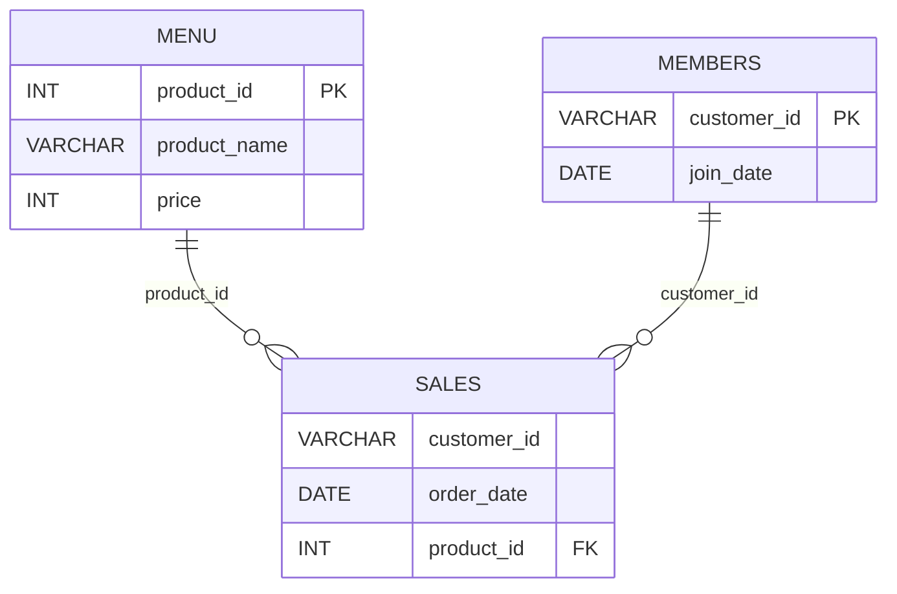

# Case Study 1: Danny's Diner

My analysis of the first case study in Danny Ma's 8 Week SQL Challenge. I will add my own SQL solutions, explanations, and findings as I work through the questions.

> This is an independent learning project and is not affiliated with or endorsed by Data With Danny. The case study and dataset are available on the [official case study page](https://8weeksqlchallenge.com/case-study-1/).

## Table of Contents

- [Business Task](#business-task)
- [Entity Relationship Diagram](#entity-relationship-diagram)
- [Questions and Solutions](#questions-and-solutions)
- [Key Findings](#key-findings)
- [What I Learned](#what-i-learned)
- [Credits](#credits)

## Business Task

Danny's Diner wants to better understand customer visits, spending, menu preferences, and its loyalty program. In this case study, I will use SQL to explore the provided sales, menu, and membership data and summarize what the results reveal.

## Entity Relationship Diagram

The case study contains three tables: `sales`, `menu`, and `members`. The `sales` table connects to `menu` through `product_id` and to `members` through `customer_id`.

## Questions and Solutions

The questions and sample data are on the [official Danny's Diner case study page](https://8weeksqlchallenge.com/case-study-1/). I am writing and explaining my own solutions below. SQL is saved in [`solutions.sql`](solutions.sql).

### 1. Customer spend

**Question:** What is the total amount each customer spent at the restaurant?

**Approach:**

<!-- Explain your approach and any assumptions here. -->

**SQL:**

<!-- Add your answer in solutions.sql and link to its section here if useful. -->

**Result:**

<!-- Add a small result table or summary here. -->

**Interpretation:**

<!-- Explain what the result means for the business. -->

---

### 2. Customer visits

**Question:** How many days has each customer visited the restaurant?

**Approach:**

<!-- Explain your approach and any assumptions here. -->

**SQL:**

<!-- Add your answer in solutions.sql and link to its section here if useful. -->

**Result:**

<!-- Add a small result table or summary here. -->

**Interpretation:**

<!-- Explain what the result means for the business. -->

---

### 3. First menu item purchased by each customer

**Approach:**

<!-- Explain your approach and any assumptions here. -->

**SQL:**

<!-- Add your answer in solutions.sql and link to its section here if useful. -->

**Result:**

<!-- Add a small result table or summary here. -->

**Interpretation:**

<!-- Explain what the result means for the business. -->

---

### 4. Most purchased menu item

**Approach:**

<!-- Explain your approach and any assumptions here. -->

**SQL:**

<!-- Add your answer in solutions.sql and link to its section here if useful. -->

**Result:**

<!-- Add a small result table or summary here. -->

**Interpretation:**

<!-- Explain what the result means for the business. -->

---

### 5. Most popular item for each customer

**Approach:**

<!-- Explain your approach and how you handle ties. -->

**SQL:**

<!-- Add your answer in solutions.sql and link to its section here if useful. -->

**Result:**

<!-- Add a small result table or summary here. -->

**Interpretation:**

<!-- Explain what the result means for the business. -->

---

### 6. First item purchased after joining

**Approach:**

<!-- Explain your approach and any assumptions here. -->

**SQL:**

<!-- Add your answer in solutions.sql and link to its section here if useful. -->

**Result:**

<!-- Add a small result table or summary here. -->

**Interpretation:**

<!-- Explain what the result means for the business. -->

---

### 7. Last item purchased before joining

**Approach:**

<!-- Explain your approach and any assumptions here. -->

**SQL:**

<!-- Add your answer in solutions.sql and link to its section here if useful. -->

**Result:**

<!-- Add a small result table or summary here. -->

**Interpretation:**

<!-- Explain what the result means for the business. -->

---

### 8. Purchases before joining

**Approach:**

<!-- Explain your approach and any assumptions here. -->

**SQL:**

<!-- Add your answer in solutions.sql and link to its section here if useful. -->

**Result:**

<!-- Add a small result table or summary here. -->

**Interpretation:**

<!-- Explain what the result means for the business. -->

---

### 9. Customer points

**Approach:**

<!-- Explain your approach and how you apply the points rules. -->

**SQL:**

<!-- Add your answer in solutions.sql and link to its section here if useful. -->

**Result:**

<!-- Add a small result table or summary here. -->

**Interpretation:**

<!-- Explain what the result means for the business. -->

---

### 10. Points earned by the end of January

**Approach:**

<!-- Explain the date window and points rules you applied. -->

**SQL:**

<!-- Add your answer in solutions.sql and link to its section here if useful. -->

**Result:**

<!-- Add a small result table or summary here. -->

**Interpretation:**

<!-- Explain what the result means for the business. -->

## Bonus Questions

### Join All The Things

**Approach:**

<!-- Explain your approach here. -->

**SQL:**

<!-- Add your answer in solutions.sql. -->

**Result:**

<!-- Add the output table here. -->

### Rank All The Things

**Approach:**

<!-- Explain how you assign ranks and handle non-member purchases. -->

**SQL:**

<!-- Add your answer in solutions.sql. -->

**Result:**

<!-- Add the output table here. -->

## Key Findings

1. <!-- Add a business finding. -->
2. <!-- Add a business finding. -->
3. <!-- Add a business finding. -->

## What I Learned

- **SQL concepts practiced:** <!-- Add the SQL concepts you used. -->
- **Most challenging part:** <!-- Describe what you found difficult. -->
- **What I would improve:** <!-- Note what you would change next time. -->

## Credits

- Case study and dataset: [Danny Ma's 8 Week SQL Challenge](https://8weeksqlchallenge.com/case-study-1/)
- SQL dialect: MySQL

The case study content and dataset belong to their original publisher. This repository contains my own SQL solutions, analysis, and learning notes. Please refer to the official page for the full questions and source data.
